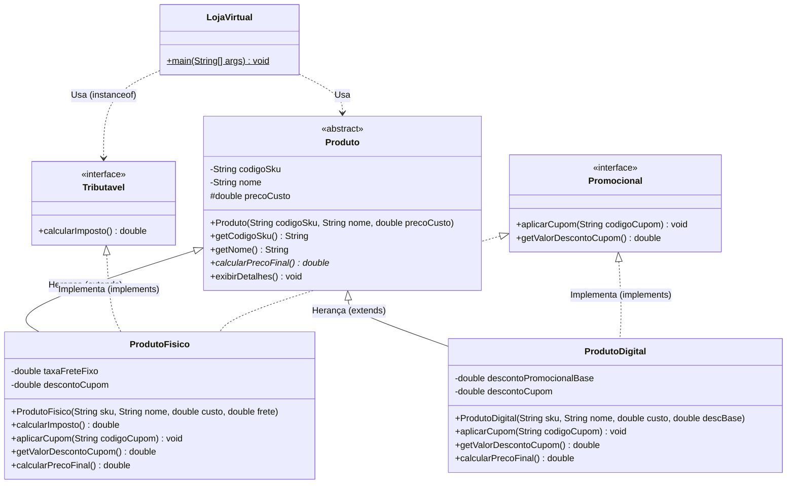
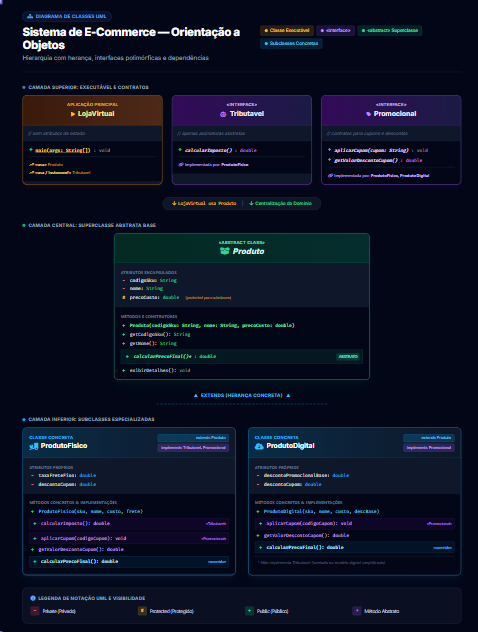

# Documentação do Sistema de E-commerce Orientado a Objetos (Java)

Este documento apresenta uma explicação detalhada de um sistema de E-commerce desenvolvido em **Java puro**, criado especificamente para demonstrar pilares fundamentais da Programação Orientada a Objetos (POO): **Classes Abstratas, Herança, Polimorfismo, Interfaces e Visibilidade de Atributos**.

## 1. Visão Geral da Arquitetura

O sistema modela diferentes tipos de produtos comercializados em uma loja virtual. Como produtos físicos e digitais possuem comportamentos e custos diferentes (por exemplo, frete e impostos para físicos versus descontos promocionais para digitais), a arquitetura utiliza um design flexível baseado em contratos e herança.

### Componentes Principais:

1. **Interfaces (`Tributavel`, `Promocional`)**: Definem comportamentos opcionais que certas categorias de produtos podem adotar.

2. **Classe Abstrata (`Produto`)**: Serve como base comum, centralizando atributos protegidos e privados, além de estabelecer a obrigatoriedade do cálculo de preço final.

3. **Classes Concretas (`ProdutoFisico`, `ProdutoDigital`)**: Especializam o comportamento da classe base e implementam as interfaces necessárias.

4. **Classe de Execução (`LojaVirtual`)**: Demonstra a execução do sistema e o uso de polimorfismo.

---

## 2. Diagrama UML do Projeto

Abaixo está a representação estrutural do nosso mini projeto em formato Mermaid. (Caso queira colocar uma imagem real como um arquivo `.png` ou `.jpg` no seu pacote, veja a instrução logo após o diagrama).



### Como colocar uma imagem real (`.png` ou `.jpg`) no Markdown:
Se você exportar o diagrama como uma imagem e quiser guardá-lo dentro do pacote (pasta) do seu projeto Java, siga estes passos:

1. Crie uma pasta chamada `imagens` ou `docs` dentro do diretório do seu projeto (junto com os arquivos `.java`).
2. Salve a imagem lá dentro (por exemplo: `diagrama_ecommerce.png`).
3. No seu arquivo `.md`, insira a imagem usando a sintaxe padrão do Markdown apontando para o caminho relativo:

```markdown

```

---

## 3. Detalhamento dos Arquivos e Código

### 3.1. Interfaces

As interfaces determinam *o que* um objeto pode fazer, sem ditar *como* ele faz.

* **`Tributavel.java`**: Identifica itens que geram impostos governamentais.

```java
public interface Tributavel {
    double calcularImposto();
}
```

* **`Promocional.java`**: Identifica itens que aceitam aplicação de cupons de desconto.

```java
public interface Promocional {
    void aplicarCupom(String codigoCupom);
    double getValorDescontoCupom();
}
```

### 3.2. A Classe Abstrata (`Produto.java`)

Esta classe não pode ser instanciada diretamente (`new Produto(...)` é proibido). Ela encapsula dados fundamentais e força as subclasses a implementarem sua própria regra de preço.

* **Visibilidade de Atributos**:
  * `private String codigoSku` e `private String nome`: Protegidos por encapsulamento estrito (acessíveis apenas via getters).
  * `protected double precoCusto`: Visível para as classes filhas, permitindo que elas realizem cálculos internos diretamente.

```java
public abstract class Produto {
    private String codigoSku;
    private String nome;
    protected double precoCusto;

    public Produto(String codigoSku, String nome, double precoCusto) {
        this.codigoSku = codigoSku;
        this.nome = nome;
        this.precoCusto = precoCusto;
    }

    public String getCodigoSku() { return codigoSku; }
    public String getNome() { return nome; }

    // Método abstrato: obriga as filhas a implementarem
    public abstract double calcularPrecoFinal();

    public void exibirDetalhes() {
        System.out.println("----------------------------------------");
        System.out.println("SKU: " + codigoSku);
        System.out.println("Produto: " + nome);
        System.out.println("Preço de Custo: R$ " + precoCusto);
        System.out.println("Preço Final de Venda: R$ " + calcularPrecoFinal());
    }
}
```

### 3.3. Classes Concretas (Herança + Interfaces)

* **`ProdutoFisico.java`**: Herda de `Produto` e implementa *duas* interfaces (`Tributavel` e `Promocional`). Adiciona taxa de frete e lógica de impostos.

```java
public class ProdutoFisico extends Produto implements Tributavel, Promocional {
    private double taxaFreteFixo;
    private double descontoCupom;

    public ProdutoFisico(String codigoSku, String nome, double precoCusto, double taxaFreteFixo) {
        super(codigoSku, nome, precoCusto);
        this.taxaFreteFixo = taxaFreteFixo;
        this.descontoCupom = 0.0;
    }

    @Override
    public double calcularImposto() { return this.precoCusto * 0.10; }

    @Override
    public void aplicarCupom(String codigoCupom) {
        if (codigoCupom.equals("DESCONTO10")) this.descontoCupom = 10.0;
    }

    @Override
    public double getValorDescontoCupom() { return this.descontoCupom; }

    @Override
    public double calcularPrecoFinal() {
        return (this.precoCusto + this.taxaFreteFixo + calcularImposto()) - this.descontoCupom;
    }
}
```

* **`ProdutoDigital.java`**: Herda de `Produto` e implementa apenas a interface `Promocional`.

```java
public class ProdutoDigital extends Produto implements Promocional {
    private double descontoPromocionalBase;
    private double descontoCupom;

    public ProdutoDigital(String codigoSku, String nome, double precoCusto, double descontoPromocionalBase) {
        super(codigoSku, nome, precoCusto);
        this.descontoPromocionalBase = descontoPromocionalBase;
        this.descontoCupom = 0.0;
    }

    @Override
    public void aplicarCupom(String codigoCupom) {
        if (codigoCupom.equals("PROMO5")) this.descontoCupom = 5.0;
    }

    @Override
    public double getValorDescontoCupom() { return this.descontoCupom; }

    @Override
    public double calcularPrecoFinal() {
        return this.precoCusto - this.descontoPromocionalBase - this.descontoCupom;
    }
}
```

## 4. Conceitos de POO Aplicados

1. **Abstração**: O conceito genérico de `Produto` isola propriedades comuns, escondendo os detalhes complexos de precificação de cada item específico.

2. **Herança (`extends`)**: Evita duplicação de código ao permitir que `ProdutoFisico` e `ProdutoDigital` aproveitem a estrutura de `Produto`.

3. **Polimorfismo**: Demonstrado no loop de execução da classe `LojaVirtual`. Iteramos sobre um array do tipo `Produto[]`, chamando `p.calcularPrecoFinal()` sem precisar saber se o item é físico ou digital — o Java executa o método correto dinamicamente.

4. **Interfaces (`implements`)**: Garantem flexibilidade comportamental. Se amanhã criarmos um `Brinde` (que não é tributável e nem promocional), basta herdar de `Produto` sem precisar forçar contratos indesejados.